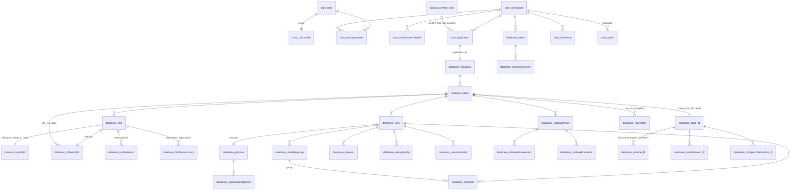

# Cấu trúc cơ sở dữ liệu PostgreSQL của Baserow

> Nguồn: đọc trực tiếp mã nguồn `github.com/baserow/baserow` (bản clone `--depth 1`, commit `af12561`, ngày 2026-10-22). Mọi đường dẫn bên dưới tính từ root repo Baserow. Viết tắt:
> - `B/` = `backend/src/baserow/`
> - `DB/` = `backend/src/baserow/contrib/database/`
> - `P/` = `premium/backend/src/baserow_premium/`
> - `E/` = `enterprise/backend/src/baserow_enterprise/`
>
> **Ranh giới license:** `backend/` (core) theo **MIT**, được phép tham khảo và tái sử dụng. `premium/` và `enterprise/` **không phải MIT** (Baserow Premium/Enterprise license). Các phần đánh dấu **[Premium]** hoặc **[Enterprise]** trong tài liệu này chỉ để **nghiên cứu thiết kế**, không copy code.
>
> **Quy tắc đặt tên bảng SQL.** Django đặt tên bảng mặc định là `<app_label>_<tên model viết thường>`, trừ khi model khai báo `Meta.db_table`. Các app label đang dùng:
>
> | App label | Code |
> |---|---|
> | `core` | `B/core` |
> | `database` | `DB/` |
> | `builder`, `automation`, `integrations`, `dashboard`, `ws` | các app tương ứng |
> | `baserow_premium` | premium |
> | `baserow_enterprise` | enterprise |
> | `auth` | `auth_user` của Django |
>
> - **Multi-table inheritance.** Bảng con có PK là `<parent>_ptr_id`, đồng thời là FK trỏ về bảng cha. Ví dụ `database_textfield.field_ptr_id → database_field.id`.
> - **M2M tự sinh.** Django tạo bảng `<app>_<model>_<field>` với hai cột `<model>_id` và `<target>_id`.
> - **Tên cũ.** Baserow từng đổi `Group` thành `Workspace` bằng `RenameModel` (`B/core/migrations/0046…0064`), nên bảng hiện tại là `core_workspace` và các cột FK là `workspace_id`.

---

## 1. Tổng quan

Dữ liệu trong Postgres của Baserow chia làm **hai lớp**.

### 1.1 Lớp metadata cố định (Django models, có migration)
Đây là các bảng sinh từ Django migration như bình thường: `core_*`, `database_*`, `builder_*`, `automation_*`, `integrations_*`, `baserow_premium_*`, `baserow_enterprise_*`. Lớp này mô tả *cấu trúc*: workspace, application, table, field, view, filter, quyền, token, webhook, trash, action log…

Hai mẫu thiết kế được dùng khắp nơi:
- **Đa hình theo `content_type`** (`PolymorphicContentTypeMixin` + FK tới `django_content_type`), kết hợp **multi-table inheritance**. Bảng cha chứa các cột chung (`database_field`, `database_view`, `core_application`, `core_job`, `core_service`, `core_integration`…). Mỗi loại con có bảng riêng chứa cột cấu hình đặc thù và trỏ về cha qua `*_ptr_id`.
- **Registry**: mỗi loại field, view, filter, job hay trash đều là một class đăng ký vào registry (`B/core/registry.py`). Cột `content_type_id` hoặc `type` xác định dùng class nào.

### 1.2 Lớp dữ liệu người dùng sinh động (DDL lúc runtime, không có migration)
- Mỗi bảng do người dùng tạo là **một bảng SQL thật**, tên `database_table_<table.id>` (`DB/table/constants.py: USER_TABLE_DATABASE_NAME_PREFIX = "database_table_"`, `Table.get_database_table_name()` trong `DB/table/models.py`).
- Mỗi field là **một cột thật** `field_<field.id>` (`Field.db_column`, `DB/fields/models.py`).
- Các bảng junction sinh động (`DB/table/constants.py`):
  - `database_relation_<link_row_relation_id>`: link row. Hai field ở hai chiều dùng chung một `link_row_relation_id`.
  - `database_multipleselect_<field.id>`: multiple select.
  - `database_multiplecollaborators_<field.id>`: multiple collaborators.
- Bảng full-text search tách riêng cho mỗi workspace: `database_search_workspace_<workspace_id>_data` (`DB/search/handler.py: get_workspace_search_table_name`).
- Sequence riêng cho autonumber: `field_<id>_seq` (`DB/fields/field_types.py`, `AutonumberFieldType`).
- Model Django tương ứng được **sinh động** bằng `Table.get_model()`. Hàm này gọi `type("Table<id>Model", (GeneratedTableModel, TrashableModelMixin, CreatedAndUpdatedOnMixin, models.Model), attrs)` với `managed=False` và `app_label = "<uuid>_database_table"`. App label là uuid để đảm bảo thread-safe.

### 1.3 Sơ đồ quan hệ chính



Lưu ý: các quan hệ từ bảng sinh động (`database_table_N` và các junction) đều tạo với `db_constraint=False`, nghĩa là **không có FOREIGN KEY constraint** ở mức Postgres. Toàn vẹn dữ liệu do code giữ.

---

## 2. Bảng lõi (core), MIT

Nguồn: `B/core/models.py`, `B/core/mixins.py`, `B/core/action/models.py`, `B/core/jobs/models.py`, `B/core/notifications/models.py`, `B/core/user_files/models.py`, `B/core/integrations/models.py`, `B/core/services/models.py`, `B/core/snapshots/models.py`, `B/core/two_factor_auth/models.py`, `B/core/graph/models.py`.

### 2.0 Mixin dùng chung (`B/core/mixins.py`)
| Mixin | Cột thêm vào | Ghi chú |
|---|---|---|
| `CreatedAndUpdatedOnMixin` | `created_on timestamptz` (auto_now_add), `updated_on timestamptz` (`SyncedDateTimeField`, auto_now) | gần như mọi bảng đều có |
| `TrashableModelMixin` | `trashed boolean default false` + index | soft delete; manager `objects` lọc bỏ `trashed`, `objects_and_trash` lấy cả hai |
| `OrderableMixin` | (cột `order` do model tự khai báo) | helper `get_last_order`, `order_objects` |
| `FractionOrderableMixin` | `order numeric(40,20)` | dùng cho integration, data source… |
| `PolymorphicContentTypeMixin` | `content_type_id → django_content_type` | `.specific` trả về instance của lớp con |
| `HierarchicalModelMixin` | không có | chỉ khai báo `get_parent()` để đi lên cây workspace → application → table… |

### 2.1 User, profile, xác thực
| Bảng SQL | Cột chính | Ghi chú |
|---|---|---|
| `auth_user` | `id`, `username`, `email`, `first_name`, `password`, `is_staff`, `is_active`, `date_joined`, `last_login` | user chuẩn của Django. Baserow dùng email làm username |
| `core_userprofile` | `user_id` (O2O, CASCADE), `language`, `timezone`, `to_be_deleted`, `concurrency_limit smallint`, `email_notification_frequency`, `last_notifications_email_sent_at`, `last_password_change`, `email_verified`, `completed_onboarding`, `completed_guided_tours text[]`, `preferences jsonb` | thông tin mở rộng của user |
| `core_blacklistedtoken` | `hashed_token varchar(64) unique`, `expires_at` | JWT refresh token đã bị thu hồi |
| `core_userlogentry` | `actor_id → auth_user`, `action ('SIGNED_IN')`, `timestamp` | |
| `core_twofactorauthprovidermodel` (+ con `core_totpauthprovidermodel`: `enabled`, `secret`, `provisioning_url`, `provisioning_qr_code`) | `content_type_id`, `user_id` (O2O) | 2FA dạng đa hình |
| `core_totpusedcode` | `user_id`, `used_at`, `code`; index `(user, code)` | chống dùng lại mã TOTP |
| `core_twofactorauthrecoverycode` | `user_id`, `code` | |
| `core_settings` | singleton: `instance_id`, `allow_new_signups`, `allow_signups_via_workspace_invitations`, `email_verification`, `co_branding_logo_id → core_userfile`… | cấu hình toàn instance |

### 2.2 Workspace và thành viên
| Bảng | Cột | Khoá / index |
|---|---|---|
| `core_workspace` | `id`, `name varchar(165)`, `trashed`, `created_on`, `updated_on`, `storage_usage int`, `storage_usage_updated_at`, `seats_taken`, `seats_taken_updated_at`, `now timestamptz` (dùng khi test), `generative_ai_models_settings jsonb` | M2M `users` qua `core_workspaceuser` |
| `core_workspaceuser` | `user_id → auth_user` CASCADE, `workspace_id → core_workspace` CASCADE, `order int` (thứ tự workspace trong sidebar), `permissions varchar(32)` (`ADMIN` / `MEMBER`, hoặc uid role khi có enterprise) | **UNIQUE (user_id, workspace_id)**, ordering `order` |
| `core_workspaceinvitation` | `workspace_id`, `invited_by_id → auth_user`, `email` (index), `permissions`, `message varchar(250)` | **UNIQUE (workspace_id, email)** |
| `core_agent` | `workspace_id`, `name`, `role_uid`, `last_active`, `trashed` | "agent" AI là một actor trong workspace, ngang hàng với user |
| `core_operation` | `name varchar(255) unique` | danh mục operation dùng cho RBAC enterprise (`Role.operations`) |

### 2.3 Application (gốc đa hình)
| Bảng | Cột | Ghi chú |
|---|---|---|
| `core_application` | `id`, `workspace_id` (nullable: template hoặc snapshot không gắn workspace), `name varchar(160)`, `order int`, `content_type_id → django_content_type`, `installed_from_template_id → core_template`, `trashed`, `created_on`, `updated_on` | ordering `order` |
| `database_database` | `application_ptr_id` (PK, FK) | Database chưa có cột riêng (`DB/models.py`) |
| `builder_builder`, `automation_automation`, `dashboard_dashboard` | `application_ptr_id` + cột riêng | |

### 2.4 Trash
`core_trashentry` (`B/core/models.py: TrashEntry`):
| Cột | Kiểu | Ý nghĩa |
|---|---|---|
| `trash_item_type` | text | tên `TrashableItemType` (`workspace`, `application`, `table`, `field`, `row`, `rows`, `view`…) |
| `trash_item_id` | int | id của đối tượng bị xoá (ví dụ id field hoặc id row) |
| `parent_trash_item_id` | int null | ví dụ `table_id` của một row |
| `trash_item_owner_id` | FK user, SET NULL | trash riêng (ví dụ view cá nhân) |
| `user_who_trashed_id` | FK user | |
| `workspace_id` | FK CASCADE | |
| `application_id` | FK CASCADE null | |
| `should_be_permanently_deleted` | bool | đánh dấu để job dọn dẹp xoá thật |
| `trashed_at` | timestamptz | |
| `name`, `names text[]`, `parent_name`, `extra_description` | text | nội dung hiển thị trong UI thùng rác |
| `related_items`, `additional_restoration_data` | jsonb | dữ liệu cần để khôi phục |
| `trash_operation_type` | varchar | |

Constraint: **UNIQUE (trash_item_type, parent_trash_item_id, trash_item_id)**, cùng UNIQUE partial `(trash_item_type, trash_item_id) WHERE parent_trash_item_id IS NULL`. Index `(-trashed_at, trash_item_type, workspace, application)`.

Bảng phụ `database_trashedrows(table_id, row_ids jsonb)` (`DB/trash/models.py`) gom nhiều row bị xoá theo lô thành **một** trash entry kiểu `rows`.

### 2.5 Action log (undo/redo)
`core_action` (`B/core/action/models.py`):
| Cột | Kiểu | Ý nghĩa |
|---|---|---|
| `user_id` | FK SET NULL | |
| `workspace_id` | FK SET NULL | |
| `session` | text, index | id phiên UI (header `ClientSessionId`). Undo chỉ áp dụng cho action cùng session |
| `type` | text, index | tên `ActionType`, ví dụ `update_rows`, `create_field` |
| `params` | jsonb | đủ dữ liệu để chạy `undo` / `redo` (giá trị cũ và mới, id…) |
| `scope` | text, index | ví dụ `root`, `workspace12`, `table42`, `view7` (`ActionScopeStr`) |
| `undone_at` | timestamptz, index | null nghĩa là chưa undo |
| `error` | text | lỗi khi undo/redo |
| `action_group` | uuid, index | gom nhiều action thành một lần undo |
| `created_on`, `updated_on` | | |

Index `(-created_on, -id)`, `(-undone_at, -id)`, `(updated_on, id)`. Các action cũ được Celery dọn theo thời gian.

### 2.6 Job (tác vụ nền đa hình)
- `core_job` (`B/core/jobs/models.py`): `content_type_id`, `user_id` (CASCADE), `progress_percentage int`, `state varchar(128)` (index: `pending` / `started` / `finished` / `failed` / `cancelled`), `error`, `human_readable_error`, `error_code`, `created_on`, `updated_on`. Index `(-updated_on)`.
- Các bảng con có PK `job_ptr_id` và thêm cột riêng. Các mixin trừu tượng `JobWithUserIpAddress` (`user_ip_address`), `JobWithWebsocketId` (`user_websocket_id`), `JobWithUndoRedoIds` (`user_session_id`, `user_action_group_id`) cũng góp thêm cột.
  - `core_duplicateapplicationjob(original_application_id, duplicated_application_id)`
  - `core_installtemplatejob(workspace_id, template_id, installed_applications jsonb)`
  - `core_exportapplicationsjob` / `core_importapplicationsjob(workspace_id, application_ids jsonb, only_structure, resource_id → core_importexportresource)`
  - `core_createsnapshotjob`, `core_restoresnapshotjob(snapshot_id)`
  - `database_duplicatetablejob`, `database_duplicatefieldjob`, `database_fileimportjob`, `database_airtableimportjob`, `database_syncdatasynctablejob`, premium `baserow_premium_generateaivaluesjob`, enterprise `baserow_enterprise_auditlogexportjob`…
- `core_importexportresource(uuid, original_name, size, created_by_id, is_valid, marked_for_deletion)`: file zip export/import.
- `core_snapshot(name, snapshot_from_application_id, snapshot_to_application_id, mark_for_deletion, created_by_id, created_at)`.

### 2.7 Notification
- `core_notification`: `created_on`, `type varchar(64)`, `broadcast bool`, `workspace_id` (CASCADE), `sender_id` (SET NULL), `data jsonb`. Index `(-created_on, -id)` và **GIN `notification_data` trên `data`**.
- `core_notificationrecipient` (through table có cột riêng): `notification_id`, `recipient_id`, `read`, `cleared`, `queued`, `email_scheduled`, `created_on`, `broadcast`, `workspace_id bigint` (denormalize). **UNIQUE (notification_id, recipient_id)**. Có partial index `unread_notif_count_idx (broadcast, cleared, read, queued, recipient_id, workspace_id) INCLUDE (notification_id) WHERE cleared=false AND read=false` để đếm số thông báo chưa đọc.

### 2.8 File, template, integration/service
- `core_userfile`: `original_name`, `original_extension`, `unique varchar(32)` (index; tên lưu trên storage), `size bigint`, `mime_type`, `is_image`, `image_width`, `image_height`, `uploaded_at`, `uploaded_by_id`, `sha256_hash` (index, để dedupe), `deleted_at`. Ô dữ liệu kiểu File trong user table chỉ lưu JSON tham chiếu `name` (là giá trị `unique` + extension).
- `core_template`, `core_templatecategory`, `core_template_categories` (M2M): template gallery, có `CheckConstraint core_template_row_role`.
- `core_integration`: `application_id`, `name`, `order numeric(40,20)`, `content_type_id`. Đa hình, ví dụ `integrations_localbaserowintegration`.
- `core_service`: `integration_id` (SET NULL), `content_type_id`, `sample_data jsonb`, `trashed`. Bảng con là các service cụ thể (`integrations_localbaserowlistrows`, `integrations_localbaserowupsertrow`…). Đi kèm `core_servicefilter`, `core_servicefiltergroup`, `core_servicesort`, có cấu trúc giống view filter.
- `core_schemaoperation(content_type_id, operation)` UNIQUE: metadata các operation trên schema.

---

## 3. Metadata của Database (Active Tables), MIT

Nguồn: `DB/models.py`, `DB/table/models.py`, `DB/fields/models.py`, `DB/fields/mixins.py`, `DB/fields/dependencies/models.py`, `DB/field_rules/models.py`, `DB/data_sync/models.py`. Field premium/enterprise ở `P/fields/models.py`, `E/field_permissions/models.py`.

### 3.1 `database_table`
| Cột | Kiểu | Ý nghĩa |
|---|---|---|
| `id` | serial | dùng để tạo tên `database_table_<id>` |
| `database_id` | FK `database_database` CASCADE | |
| `name` | varchar(255) | đổi tên chỉ sửa cột này, không có DDL |
| `order` | int | thứ tự trong sidebar |
| `_row_count`, `_row_count_updated_at` | int, ts | cache số dòng |
| `version` | text, default `'initial_version'` | **khoá cache model**: đổi sang uuid mới mỗi khi schema đổi (§7) |
| `needs_background_update_column_added` | bool | bảng có cột legacy `needs_background_update` |
| `created_by_column_added`, `last_modified_by_column_added` | bool (default true) | bảng có cột hệ thống `created_by_id` / `last_modified_by_id`. Bảng cũ được thêm lazy |
| `field_rules_validity_column_added` | bool | bảng có cột `field_rules_are_valid` |
| `missing_m2m_indexes_added` | bool | đã bổ sung index cho junction cũ |
| `trashed`, `created_on`, `updated_on` | | |

Bảng liên quan:
- `database_tableusage(table_id O2O, row_count, row_count_updated_at, storage_usage, storage_usage_updated_at)` và `database_tableusageupdate(id bigint, table_id, row_count, timestamp)`.
- `database_richtextfieldmention(table_id, row_id, field_id, user_id, marked_for_deletion_at)`, UNIQUE `(table, row_id, field, user)`: các mention @user trong rich text.

### 3.2 `database_field` (bảng cha của mọi loại field)
| Cột | Kiểu | Ý nghĩa |
|---|---|---|
| `id` | serial | tạo tên cột `field_<id>` |
| `table_id` | FK CASCADE | |
| `name` | varchar(255), index | tên hiển thị, dùng khi API bật `user_field_names=true` |
| `order` | int | thứ tự mặc định |
| `primary` | bool | field chính (luôn có đúng một) |
| `content_type_id` | FK `django_content_type` | loại field, xác định bảng con |
| `description` | text null | |
| `read_only`, `immutable_type`, `immutable_properties` | bool | khoá cấu hình (dùng cho data sync) |
| `db_index` | bool | tạo B-tree index trên cột `field_<id>` (nếu loại field hỗ trợ) |
| `tsvector_column_created` | bool | legacy: đã có cột `tsv_field_<id>` |
| `search_data_initialized_at` | ts null | search kiểu mới đã được khởi tạo |
| `trashed`, `created_on`, `updated_on` | | |

Ordering `(-primary, order)`. Quan hệ M2M `field_dependencies` đi qua `database_fielddependency` (§3.5). `database_fieldconstraint(field_id, type_name, trashed)` UNIQUE `(field, type_name)`: ràng buộc như unique value, áp thành constraint thật trên cột của user table (`build_django_field_constraints` trong `DB/fields/handler.py`).

### 3.3 Bảng con theo loại field (multi-table inheritance, PK `field_ptr_id`)
Tên bảng mặc định là `database_<model lowercase>`. Bảng nào chỉ có `field_ptr_id` nghĩa là loại đó không có cấu hình riêng.

| `type` (registry) | Bảng SQL | Cột cấu hình |
|---|---|---|
| `text` | `database_textfield` | `text_default varchar(255)` |
| `long_text` | `database_longtextfield` | `long_text_enable_rich_text bool` |
| `url` | `database_urlfield` | (không có) |
| `email` | `database_emailfield` | (không có) |
| `phone_number` | `database_phonenumberfield` | (không có) |
| `number` | `database_numberfield` | `number_decimal_places int`, `number_negative bool`, `number_prefix varchar(10)`, `number_suffix varchar(100)`, `number_separator varchar(16)`, `number_default numeric(50,20)` |
| `rating` | `database_ratingfield` | `max_value smallint`, `color`, `style` |
| `boolean` | `database_booleanfield` | `boolean_default bool` |
| `date` | `database_datefield` | `date_format`, `date_include_time`, `date_time_format`, `date_show_tzinfo`, `date_force_timezone` (từ `BaseDateMixin`, `DB/fields/mixins.py`), `date_default_now` |
| `last_modified` / `created_on` | `database_lastmodifiedfield` / `database_createdonfield` | các cột của `BaseDateMixin` |
| `last_modified_by` / `created_by` | `database_lastmodifiedbyfield` / `database_createdbyfield` | (không có) |
| `duration` | `database_durationfield` | `duration_format varchar(32)` |
| `link_row` | `database_linkrowfield` | `link_row_table_id → database_table` (CASCADE), `link_row_related_field_id → database_field` (self, SET NULL; field ở chiều ngược lại), `link_row_relation_id int` (**`SerialField`**, lấy từ sequence `database_linkrowfield_link_row_relation_id_seq`; hai chiều dùng chung giá trị nên chung bảng junction), `link_row_limit_selection_view_id → database_view`, `link_row_multiple_relationships bool` |
| `file` | `database_filefield` | (không có) |
| `single_select` | `database_singleselectfield` | `single_select_default bigint` (id option) |
| `multiple_select` | `database_multipleselectfield` | `multiple_select_default bigint[]` |
| `formula` | `database_formulafield` | `formula text` (công thức người dùng nhập), `internal_formula text` (dạng tham chiếu theo id), `version int`, `requires_refresh_after_insert`, `old_formula_with_field_by_id`, `error`, `nullable`, `formula_type text` (`text` / `number` / `date` / `boolean` / `array` / `single_select`…), `array_formula_type`, các cột định dạng `number_*`, `date_*`, `duration_format`, `needs_periodic_update bool` (formula có `now()`/`today()`), `expand_formula_when_referenced` |
| `count` | `database_countfield` (PK `formulafield_ptr_id`) | `through_field_id → database_field` (field link_row) |
| `rollup` | `database_rollupfield` | `through_field_id`, `target_field_id`, `rollup_function varchar(64)` |
| `lookup` | `database_lookupfield` | `through_field_id`, `target_field_id`, `through_field_name`, `target_field_name` |
| `multiple_collaborators` | `database_multiplecollaboratorsfield` | `notify_user_when_added bool`, `multiple_collaborators_default bigint[]` |
| `uuid` | `database_uuidfield` | (không có) |
| `autonumber` | `database_autonumberfield` | (không có; sequence `field_<id>_seq` là đối tượng DB) |
| `password` | `database_passwordfield` | `allow_endpoint_authentication bool` |
| `form_view_edit_row` | `database_formvieweditrowfield` | `form_view_id → database_formview` |
| `button` | `database_buttonfield` | `label varchar(255)` |
| `ai` **[Premium]** | `baserow_premium_aifield` (`P/fields/models.py`, migration `P/migrations/0017_aifield.py`) | `ai_generative_ai_type`, `ai_generative_ai_model`, `ai_output_type`, `ai_temperature float`, `ai_prompt` (formula), `ai_file_field_id`, `ai_auto_update`, `ai_auto_update_user_id`, `long_text_enable_rich_text` |

`count`, `rollup` và `lookup` là **lớp con của `FormulaField`**: bảng `database_countfield` trỏ về `database_formulafield`, bảng này lại trỏ về `database_field`, tức là thừa kế ba tầng. Khi lưu, Baserow tự sinh `formula` nội bộ (ví dụ `lookup('link','name')`), nên cách lưu trữ và tính toán giống hệt formula.

**Select option** (`DB/fields/models.py: SelectOption`, bảng `database_selectoption`): `field_id` (CASCADE, related `select_options`), `value varchar(255)`, `color varchar(255)`, `order int`. Dùng chung cho single select, multiple select và formula kiểu select. Ordering `(order, id)`.

**Bảng premium/enterprise gắn với field:**
- `baserow_premium_aifieldscheduledupdate(id bigint, field_id, row_id, updated_on)`, UNIQUE `(field_id,row_id)`: hàng đợi tính lại giá trị AI.
- **[Enterprise]** `baserow_enterprise_fieldpermissions(field_id O2O, role text, allow_in_forms bool)` (`E/field_permissions/models.py`): quyền ghi theo field (ví dụ chỉ role "builder" được sửa).
- **[Enterprise]** `baserow_enterprise_datedependency` (kế thừa `database_fieldrule`, `E/date_dependency/models.py`): ràng buộc ngày giữa các row (kiểu Gantt).

### 3.4 Field rules, data sync
- `database_fieldrule(table_id, is_active, is_valid, error_text, content_type_id, created_on, updated_on)` (`DB/field_rules/models.py`): luật kiểm tra mức row. Kết quả lưu vào cột hệ thống `field_rules_are_valid` của user table.
- `database_datasync(table_id O2O, last_sync, last_error, content_type_id, auto_add_new_properties, delete_unmatched_rows, two_way_sync, two_way_sync_consecutive_failures)` và các bảng con `database_icalcalendardatasync(ical_url)`, `database_postgresqldatasync(postgresql_host, …, postgresql_table, postgresql_sslmode)`, enterprise `LocalBaserowTableDataSync`…
- `database_datasyncsyncedproperty(data_sync_id, field_id, key, unique_primary, metadata jsonb)`: ánh xạ cột nguồn sang field.

### 3.5 `database_fielddependency`
(`DB/fields/dependencies/models.py`)
| Cột | Ý nghĩa |
|---|---|
| `dependant_id → database_field` CASCADE | field phụ thuộc (ví dụ formula) |
| `dependency_id → database_field` CASCADE, null | field bị tham chiếu. Null khi tham chiếu bị gãy |
| `via_id → database_linkrowfield` CASCADE, null | đi qua link row nào (cho lookup hoặc formula xuyên bảng) |
| `broken_reference_field_name` text, index | tên field đã bị xoá hoặc đổi tên. Khi một field mới có đúng tên này xuất hiện, tham chiếu tự nối lại |

Đây là **đồ thị phụ thuộc chuẩn hoá**. `FieldDependencyHandler` chạy BFS theo tầng để biết cần cập nhật gì (`group_all_dependent_fields_by_level`) và kiểm tra vòng lặp (`circular_reference_checker.py`). `FieldUpdateCollector` (`DB/fields/dependencies/update_collector.py`) gom các câu `UPDATE` theo từng tầng.

---

## 4. Views, MIT (Kanban/Calendar/Timeline là Premium)

Nguồn: `DB/views/models.py`. Premium: `P/views/models.py`.

### 4.1 `database_view` (bảng cha)
| Cột | Kiểu | Ý nghĩa |
|---|---|---|
| `table_id` | FK CASCADE | |
| `order` | int | |
| `name` | varchar(255) | |
| `content_type_id` | FK | loại view |
| `filter_type` | varchar(3) `AND`/`OR` | toán tử ở cấp gốc của bộ lọc |
| `filters_disabled` | bool | tạm tắt filter |
| `slug` | slug, **unique** | dùng cho link public |
| `public` | bool, index | |
| `public_view_password` | varchar(128) | **hash** mật khẩu của link public (hash kiểu Django) |
| `show_logo`, `allow_public_export` | bool | |
| `owned_by_id` | FK user SET NULL | chủ của view cá nhân |
| `ownership_type` | varchar(255), default `collaborative` | `collaborative` / `personal` (personal là premium) |
| `db_index_name` | varchar(30) null | tên index Postgres được **tự tạo cho thứ tự sort của view này** (`ViewIndexingHandler`, `DB/views/handler.py`) |
| `trashed`, `created_on`, `updated_on` | | |

Có partial index `database_view_public_id_idx (-id) INCLUDE (table_id) WHERE public AND NOT trashed`.

### 4.2 Bảng con theo loại view (PK `view_ptr_id`)
| Loại | Bảng | Cột riêng |
|---|---|---|
| grid | `database_gridview` | `row_identifier_type` (`id`/`count`), `row_height_size`, `frozen_column_count smallint`, `group_by_layout` |
| gallery | `database_galleryview` | `card_cover_image_field_id → database_field` |
| form | `database_formview` | `title`, `description`, `mode` (`form` / `survey`), `cover_image_id`, `logo_image_id → core_userfile`, `submit_text`, `submit_action` (`MESSAGE` / `REDIRECT`), `submit_action_message`, `submit_action_redirect_url`; M2M `users_to_notify_on_submit` (bảng `database_formview_users_to_notify_on_submit`) |
| kanban **[Premium]** | `database_kanbanview` (đặt `db_table` tường minh) | `single_select_field_id`, `card_cover_image_field_id` |
| calendar **[Premium]** | `database_calendarview` | `date_field_id`, `ical_public bool`, `ical_slug unique` |
| timeline **[Premium]** | `database_timelineview` | `start_date_field_id`, `end_date_field_id`, `timescale` (`day`/`week`/`month`/`year`) |

Các view premium vẫn nằm trong namespace bảng `database_` vì migration của premium đặt `db_table` tường minh (`P/migrations/0003_kanban_view.py`, `0008_calendar_view.py`, `0020_timelineview…`).

### 4.3 Filter, sort, group by, decoration, default values (chuẩn hoá thành bảng)
| Bảng | Cột | Ghi chú |
|---|---|---|
| `database_viewfiltergroup` | `view_id`, `filter_type` (AND/OR), `parent_group_id → self` CASCADE | **cây filter lồng nhau** |
| `database_viewfilter` | `view_id`, `field_id` (CASCADE: xoá field thì filter tự mất), `type varchar(48)` (ví dụ `equal`, `contains`, `date_is_within`, `link_row_has`…), `value text` (luôn là chuỗi, mỗi filter type tự parse), `group_id → viewfiltergroup` null | null group nghĩa là filter ở cấp gốc, dùng `view.filter_type` |
| `database_viewsort` | `view_id`, `field_id`, `order` (`ASC`/`DESC`), `type varchar(32)` (`default` hoặc kiểu sort đặc biệt), `priority smallint` | ordering `(priority, id)` |
| `database_viewgroupby` | `view_id`, `field_id`, `order`, `type`, `width int`, `priority` | |
| `database_viewdecoration` | `view_id`, `type` (`left_border_color`, `background_color`), `value_provider_type` (`single_select_color`, `conditional_color`), `value_provider_conf jsonb`, `order smallint` | **ngoại lệ**: cấu hình decoration lưu bằng JSON |
| `database_viewdefaultvalue` | `view_id`, `field_id`, `enabled`, `value jsonb`, `field_type`, `function` | UNIQUE `(view, field)` |

### 4.4 Field options theo view (một bảng cho mỗi loại view)
| Bảng | Cột | Unique |
|---|---|---|
| `database_gridviewfieldoptions` | `grid_view_id`, `field_id`, `width int (200)`, `hidden`, `order smallint (32767)`, `aggregation_type`, `aggregation_raw_type` (aggregation ở footer) | `(grid_view, field)` |
| `database_galleryviewfieldoptions` | `gallery_view_id`, `field_id`, `hidden (true)`, `order` | `(gallery_view, field)` |
| `database_formviewfieldoptions` | `form_view_id`, `field_id`, `name`, `description`, `enabled`, `required`, `include_all_select_options`, `show_when_matching_conditions`, `condition_type`, `field_component`, `order` | `(form_view, field)` |
| `database_formviewfieldoptionsallowedselectoptions` | `form_view_field_options_id`, `select_option_id` | M2M through tường minh |
| `database_formviewfieldoptionsconditiongroup` / `database_formviewfieldoptionscondition` | `field_option_id`, `field_id`, `type`, `value`, `group_id` | điều kiện hiện/ẩn field trong form, cùng cấu trúc với view filter |
| `database_kanbanviewfieldoptions`, `database_calendarviewfieldoptions`, `database_timelineviewfieldoptions` **[Premium]** | `<x>_view_id`, `field_id`, `hidden (true)`, `order` | `(<x>_view, field)` |

Field options được tạo lazy: thiếu dòng nào thì `get_field_options(create_if_missing=True)` tạo dòng đó. Giá trị mặc định `order = 32767` nghĩa là xếp cuối.

### 4.5 Bảng hỗ trợ khác
- `database_viewrows(view_id O2O, row_ids int[], created_on, updated_on)`: snapshot các row đang thoả filter của view. Dùng để phát sự kiện webhook `view.rows_entered` (event type này đăng ký ở `E/webhook_event_types.py`, tức là **[Enterprise]**; bảng `ViewRows` thì nằm ở core).
- `database_viewsubscription(view_id, subscriber_content_type_id, subscriber_id)`, UNIQUE: những ai (webhook, automation node…) đang theo dõi view.
- Public view: không có bảng token riêng. Dùng `database_view.slug` cộng `public_view_password` (hash). Sau khi nhập đúng mật khẩu, server cấp một *authorization token* cho view, client gửi lại token này qua header (`DB/api/views/utils.py: get_public_view_authorization_token`). Token không được lưu vào DB. Calendar có thêm `ical_slug` để publish feed iCal.

---

## 5. Bảng dữ liệu người dùng sinh động (`database_table_<id>`)

Nguồn: `DB/table/models.py` (`Table.get_model`, `_add_created_by`, `_add_last_modified_by`, `_add_field_rules_valid`), `DB/table/constants.py`, `DB/fields/field_types.py` (`get_model_field`, `after_model_generation`), `DB/fields/fields.py` (các field Django tuỳ biến), `DB/formula/types/formula_types.py`.

### 5.1 Cột hệ thống
| Cột | Kiểu Postgres | Nguồn |
|---|---|---|
| `id` | integer PK tự tăng (Django `AutoField`) | mặc định |
| `created_on` | timestamptz | `CreatedAndUpdatedOnMixin` |
| `updated_on` | timestamptz | `CreatedAndUpdatedOnMixin` (`SyncedDateTimeField`) |
| `trashed` | boolean default false, có index | `TrashableModelMixin`: xoá row là soft delete |
| `order` | **numeric(40,20) default 1** | `field_attrs["order"] = DecimalField(max_digits=40, decimal_places=20)` |
| `created_by_id` | integer null, **không có FK constraint** | `_add_created_by` (`IgnoreMissingForeignKey(User, db_constraint=False, on_delete=DO_NOTHING)`), khi `table.created_by_column_added` |
| `last_modified_by_id` | integer null, không có FK constraint | `_add_last_modified_by` |
| `needs_background_update` | boolean (legacy, deprecated) | chỉ có khi `needs_background_update_column_added` |
| `field_rules_are_valid` | boolean | khi `field_rules_validity_column_added` (`FieldRuleHandler.STATE_COLUMN_NAME`) |
| `tsv_field_<id>` | tsvector (legacy) | search kiểu cũ (`get_tsv_vector_field_name`) |

Index mặc định là `tbl_order_id_<table_id>_idx ON (order, id)` (`get_collision_safe_order_id_idx_name`), và ordering mặc định cũng là `["order", "id"]`. Ngoài ra còn index cho từng field có `db_index=true`, và index theo sort của view (`database_view.db_index_name`).

**Order dạng decimal**: khi chèn row vào giữa, `RowHandler.get_unique_orders_before_row` (`DB/rows/handler.py`) tính giá trị order nằm giữa hai row bằng phân số, dùng `get_unique_orders_before_item`. Khi hết khoảng trống ở 20 chữ số thập phân, `recalculate_row_orders` đánh số lại cả bảng và phát signal `row_orders_recalculated`.

### 5.2 Kiểu cột theo loại field (`get_model_field()`)
Tất cả đều có `db_column = "field_<id>"`. Riêng field bị trash thì thuộc tính Python đổi tên thành `trashed_field_<id>` (cột SQL vẫn giữ tên cũ) và không hiện trong API.

| Loại | Django field | Kiểu Postgres |
|---|---|---|
| `text` | `TextField(null=True, default=text_default)` | `text` |
| `long_text` | `TextField(null=True)` | `text` (rich text lưu dạng markdown) |
| `url` | `TextFieldMatchingRegexFieldType`, tức `TextField` + validator | `text` |
| `email` | `CharField(max_length=254)` + validator | `varchar(254)` |
| `phone_number` | `CharField` + validator | `varchar(n)` |
| `number` | `DecimalField(max_digits=50+decimal_places, decimal_places=…)` | `numeric(50+d, d)` |
| `rating` | `PositiveSmallIntegerField(default=0, null=False)` | `smallint` + CHECK ≥ 0 |
| `boolean` | `BooleanField(default=boolean_default)` | `boolean NOT NULL` |
| `date` | `DateTimeField` nếu `date_include_time`, ngược lại `DateField` | `timestamptz` / `date` |
| `created_on` / `last_modified` | `SyncedDateTimeField` / `BaserowLastModifiedField` (`sync_with_add="created_on"` …) | `timestamptz`: **cột riêng**, đồng bộ từ cột hệ thống |
| `created_by` / `last_modified_by` | `SyncedUserForeignKeyField(User, db_constraint=False, SET_NULL)` | `integer` (không có FK constraint) |
| `duration` | `DurationField` (custom) | `interval` |
| `file` | `JSONField(default=list)` | `jsonb`: mảng `{name, visible_name, size, mime_type, is_image, image_width, image_height, uploaded_at}` |
| `single_select` | `SingleSelectForeignKey(to=SelectOption, db_constraint=False, SET_NULL)` | `integer` (id của `database_selectoption`, không có FK constraint) |
| `multiple_select` | không có cột. `MultipleSelectManyToManyField` | junction `database_multipleselect_<field_id>` |
| `multiple_collaborators` | không có cột. `MultipleSelectManyToManyField(to=User)` | junction `database_multiplecollaborators_<field_id>` |
| `link_row` | không có cột (`get_model_field` trả `None`). `ManyToManyField` được gắn trong `after_model_generation` | junction `database_relation_<link_row_relation_id>` |
| `formula` / `count` / `rollup` / `lookup` | `SpecializedBaserowExpressionField` (`db_type` lấy theo `formula_type`) | **cột thật**: `text` / `numeric` / `boolean` / `timestamptz` / `interval`. Formula trả mảng, link, file hay select thì lưu `jsonb` (`BaserowFormulaArrayType`, `…SingleSelectType`, `…MultipleSelectType`, `…LinkType`, `…SingleFileType` đều dùng `JSONField`) |
| `uuid` | `UUIDField(default=uuid4)` | `uuid` |
| `autonumber` | `IntegerFieldWithSequence` (`pre_save` dùng `nextval('field_<id>_seq')`) | `integer` + `SEQUENCE field_<id>_seq OWNED BY` cột đó |
| `password` | `CharField(max_length=128)` | `varchar(128)` (hash) |
| `form_view_edit_row` | `UUIDField(db_default=RandomUUID())` | `uuid` |
| `button` | `NoDatabaseColumnField` (không phải cột thật) | **không có cột** |
| `ai` **[Premium]** | tuỳ `ai_output_type`: text, hoặc choice dạng single select | `text` / `integer` |

### 5.3 Junction table sinh động
Ba loại junction đều được Django tự tạo qua `ManyToManyField(..., db_table=<tên>, db_constraint=False)`. Cột của chúng theo quy ước auto-created through của Django: `<tên model nguồn lowercase>_id` và `<tên model đích lowercase>_id`, với model sinh động tên `Table<id>Model`.

| Junction | Định nghĩa | Cột (theo quy ước Django) |
|---|---|---|
| `database_relation_<R>` | `LinkRowFieldType.after_model_generation` (`DB/fields/field_types.py`): `models.ManyToManyField(to=related_model, related_name=…, db_table=instance.through_table_name, db_constraint=False)` | `id`, `table<A>model_id`, `table<B>model_id`. Link tới chính bảng mình: `from_table<A>model_id`, `to_table<A>model_id` |
| `database_multipleselect_<F>` | `MultipleSelectManyToManyField(to=SelectOption, db_table=…)`, cộng field ngược trên `SelectOption` | `id`, `table<T>model_id`, `selectoption_id` |
| `database_multiplecollaborators_<F>` | `MultipleSelectManyToManyField(to=User, additional_filters={id IN workspace users})` | `id`, `table<T>model_id`, `user_id` |

Bằng chứng về cách đặt tên cột: migration `DB/migrations/0050_remove_multiselect_missing_options.py` truy vấn trực tiếp cột `multipleselectfield<id>selectoption_id` của `database_multipleselect_<id>` (theo tên model cũ). `DB/db/schema.py` và `backup_handler.py` lấy tên cột qua `m2m_field_name()` / `m2m_column_name()` chứ không hard-code. Vì vậy tên cột cụ thể phụ thuộc tên model sinh động tại thời điểm tạo. Code mới của Tago không nên dựa vào quy ước này.

`database_relation_<R>` không có FK constraint. Khi row bị trash, quan hệ vẫn còn trong junction và được lọc ra lúc đọc. Field link row hai chiều dùng chung một bảng junction (cùng `link_row_relation_id`). Field link row có tuỳ chọn `has_related_field=false` (link một chiều), khi đó `link_row_related_field` là null.

### 5.4 Formula, lookup và rollup được materialize thành cột thật
- Khi tạo hoặc sửa formula, `FormulaFieldType` biên dịch `formula` thành `internal_formula`, rồi typecheck để ra `formula_type`. Từ `formula_type` suy ra `db_type`, và Baserow `ADD COLUMN` hoặc `ALTER COLUMN TYPE` cho cột `field_<id>`.
- Giá trị được **tính bằng SQL** (Django expression sinh từ AST) và ghi bằng `UPDATE database_table_N SET field_<id> = <expr> WHERE …`. Với lookup/rollup, expr là subquery hoặc aggregate qua junction `database_relation_R`, rồi `jsonb_agg` ra JSON cho kiểu mảng.
- Khi một row thay đổi, `FieldUpdateCollector` duyệt `database_fielddependency` theo tầng. Nó chỉ cập nhật các row bị ảnh hưởng (`starting_row_ids`, và qua junction khi formula xuyên bảng). Lý do formula đắt khi ghi: đọc, lọc và sắp xếp trên cột đã tính thì nhanh như cột thường, nhưng mỗi lần ghi row có thể kéo theo `UPDATE` trên nhiều bảng.
- Formula có `now()`/`today()` được đánh dấu `needs_periodic_update` và Celery beat định kỳ tính lại.

### 5.5 Ví dụ DDL minh hoạ
Ví dụ: table `id=42` có các field: 101 "Tên" (text, primary), 102 "Giá" (number, 2 chữ số thập phân), 103 "Đã chốt" (boolean), 104 "Hạn" (date có giờ), 105 "Trạng thái" (single select), 106 "Khách hàng" (link_row tới table 43, `link_row_relation_id=7`), 107 "Tags" (multiple select), 108 "Tệp" (file), 109 "Email khách" (lookup qua 106), 110 "Mã" (autonumber), 111 "Thành tiền" (formula number). Đây là DDL tương đương do Baserow sinh (đã đơn giản hoá):

```sql
CREATE TABLE database_table_42 (
  id                   integer GENERATED BY DEFAULT AS IDENTITY PRIMARY KEY,
  created_on           timestamptz NOT NULL,
  updated_on           timestamptz NOT NULL,
  trashed              boolean NOT NULL DEFAULT false,
  "order"              numeric(40,20) NOT NULL DEFAULT 1,
  created_by_id        integer NULL,          -- không có FK constraint
  last_modified_by_id  integer NULL,          -- không có FK constraint
  field_101            text NULL,             -- text (primary)
  field_102            numeric(52,2) NULL,    -- number, decimal_places=2
  field_103            boolean NOT NULL DEFAULT false,
  field_104            timestamptz NULL,      -- date_include_time=true
  field_105            integer NULL,          -- id database_selectoption, không FK
  field_108            jsonb NOT NULL DEFAULT '[]',   -- file
  field_109            jsonb NULL,            -- lookup -> formula array (materialized)
  field_110            integer NULL,          -- autonumber
  field_111            numeric(52,2) NULL     -- formula number (materialized)
  -- field_106 (link_row) và field_107 (multiple_select) KHÔNG có cột
);
CREATE INDEX tbl_order_id_42_idx ON database_table_42 ("order", id);
CREATE INDEX ON database_table_42 (trashed);

CREATE SEQUENCE field_110_seq OWNED BY database_table_42.field_110;
ALTER TABLE database_table_42 ALTER COLUMN field_110 SET DEFAULT nextval('field_110_seq');

-- link_row 106 <-> field ngược ở table 43, dùng chung relation id 7
CREATE TABLE database_relation_7 (
  id               integer GENERATED BY DEFAULT AS IDENTITY PRIMARY KEY,
  table42model_id  integer NOT NULL,
  table43model_id  integer NOT NULL,
  UNIQUE (table42model_id, table43model_id)
);
-- multiple select 107
CREATE TABLE database_multipleselect_107 (
  id               integer GENERATED BY DEFAULT AS IDENTITY PRIMARY KEY,
  table42model_id  integer NOT NULL,
  selectoption_id  integer NOT NULL,
  UNIQUE (table42model_id, selectoption_id)
);

-- Cập nhật formula 111 khi field_102 đổi (minh hoạ, Baserow sinh từ AST):
UPDATE database_table_42 SET field_111 = field_102 * 1.1 WHERE id IN (...);
```

(Unique trên junction và index trên các cột `_id` là mặc định của M2M Django. Cờ `missing_m2m_indexes_added` dùng để bổ sung các index này cho bảng cũ.)

---

## 6. Các nhóm bảng khác

### 6.1 Row history, MIT (`DB/rows/models.py`)
`database_rowhistory`:
| Cột | Ý nghĩa |
|---|---|
| `user_id` (thuộc tính Python là `actor_id`, `db_column="user_id"`), `actor_type`, `user_name` (`actor_name`) | actor (user hoặc agent). Giữ tên cột cũ để không phải migrate dữ liệu |
| `table_id` FK CASCADE, `row_id` int (không FK) | |
| `field_names varchar[]` | các field đã đổi |
| `fields_metadata jsonb` | loại field và metadata tại thời điểm ghi |
| `action_uuid`, `action_command_type` (`DO`/`UNDO`/`REDO`), `action_type`, `action_timestamp` | liên kết với `core_action` |
| `before_values jsonb`, `after_values jsonb` | giá trị trước và sau, key `field_<id>` |

Index `(action_timestamp)` và `(table, row_id, -action_timestamp, -id)`. Giữ theo `BASEROW_ROW_HISTORY_RETENTION_DAYS` (mặc định 180 ngày, `B/config/settings/base.py`).

### 6.2 Row comments **[Premium]** (`P/row_comments/models.py`)
- `database_rowcomment` (đặt `db_table` tường minh): `table_id`, `row_id`, `user_id`, `comment text` (legacy), `message jsonb` (rich text), `trashed`, `created_on`, `updated_on`. M2M `mentions` qua `database_rowcomment_mentions`. Index `(table, row_id, -created_on)`.
- `baserow_premium_rowcommentsnotificationmode(table_id, row_id, user_id, mode)`, UNIQUE `(table,row_id,user)`.

### 6.3 Database tokens, MIT (`DB/tokens/models.py`)
- `database_token`: `name varchar(100)`, `key varchar(32) unique`, `created`, `user_id`, `workspace_id`, `handled_calls int`, `last_call`. Token gắn với **một workspace**.
- `database_tokenpermission`: `token_id`, `type` ∈ `create`/`read`/`update`/`delete` (index), `database_id` null, `table_id` null. Cả `database_id` và `table_id` đều null nghĩa là áp cho mọi bảng. Có `database_id` nghĩa là mọi bảng trong database đó. Có `table_id` nghĩa là riêng bảng đó. Không có dòng nào cho một `type` nghĩa là không có quyền đó.

### 6.4 Webhooks, MIT (`DB/webhooks/models.py`)
| Bảng | Cột |
|---|---|
| `database_tablewebhook` | `table_id`, `active`, `use_user_field_names`, `url text`, `request_method` (`POST`/`GET`/`PUT`/`PATCH`/`DELETE`), `name`, `include_all_events`, `failed_triggers int` (đủ ngưỡng thì tự tắt), `created_on`, `updated_on` |
| `database_tablewebhookevent` | `webhook_id`, `event_type varchar(50)` (core: `rows.created`, `rows.updated`, `rows.deleted`, `field.created/updated/deleted`, `view.created/updated/deleted`; enterprise thêm `view.rows_entered`). M2M `fields` (`database_tablewebhookevent_fields`): chỉ phát khi các field này đổi. M2M `views` (`database_tablewebhookevent_views`) |
| `database_tablewebhookheader` | `webhook_id`, `name`, `value` |
| `database_tablewebhookcall` | `event_id uuid`, `batch_id`, `webhook_id`, `event_type`, `called_time`, `called_url`, `request text`, `response text`, `response_status`, `error`. UNIQUE `(event_id, batch_id, webhook, event_type)`. Giữ N call gần nhất |

### 6.5 Search, MIT (`DB/search/models.py`, `DB/search/handler.py`)
- **Kiểu mới**: mỗi workspace có một bảng `database_search_workspace_<ws_id>_data`, được sinh động (`app_label="database_search"`, `managed=False`, tạo bằng `schema_editor.create_model`). Các cột: `id bigint`, `row_id int`, `field_id int`, `updated_on`, `value tsvector`. **UNIQUE (field_id, row_id)**, cùng GIN index `database_workspace_<ws>_value_tsv_idx` trên `value`. Bảng không chứa `table_id`: `field_id` đã đủ để xác định bảng.
- `database_pendingsearchvalueupdate(id bigint, field_id, row_id null, updated_on, deletion_workspace_id null)`: hàng đợi cập nhật search, UNIQUE `(field_id,row_id)`. `row_id` null nghĩa là cập nhật cả field. Partial index cho các bản ghi xoá.
- **Kiểu cũ**: cột `tsv_field_<id>` nằm ngay trong user table, còn lại để tương thích (`Field.tsvector_column_created`).

### 6.6 Import/Export, MIT
- `database_exportjob` (`DB/export/models.py`, model độc lập, không kế thừa `core_job`): `user_id`, `table_id`, `view_id`, `exporter_type` (`csv`/`json`/`xml`/`excel`), `state`, `exported_file_name`, `error`, `created_at`, `progress_percentage float`, `export_options jsonb`. Index `(created_at, user, state)`.
- `database_fileimportjob` (job con): `database_id`, `name`, `table_id`, `data_file`, `first_row_header`, `importer_type`, `original_file_name`, `report jsonb` (lỗi theo từng dòng).
- `database_airtableimportjob(workspace_id, airtable_share_id, database_id, skip_files, session, session_signature)`.
- Import/export application: `core_exportapplicationsjob` / `core_importapplicationsjob` cộng `core_importexportresource` (§2.6).

### 6.7 Integrations, automation, builder (tóm tắt), MIT
- **Integrations** (`B/core/integrations`, `B/core/services`, `B/contrib/integrations/**`): `core_integration` (đa hình: `integrations_localbaserowintegration`, SMTP, AI, Slack…), `core_service` (đa hình, mỗi service một bảng con như `integrations_localbaserowlistrows`, `…getrow`, `…upsertrow`, `…rowscreated`…), `core_servicefilter` / `core_servicefiltergroup` / `core_servicesort`.
- **Automation** (`B/contrib/automation/**`):
  - `automation_automation` (Application) có nhiều `automation_automationworkflow`. Workflow có `automation_id`, `name`, `state` (`draft`/`live`/`paused`/`disabled`), `order`, `allow_test_run_until`, `simulate_until_node_id`, cùng **`graph jsonb`** (`GraphModelMixin`, `B/core/graph/models.py`: cạnh nối giữa các node).
  - `automation_automationnode` (đa hình): `workflow_id`, `service_id` (O2O `core_service`), `label`, `on_failure`, `trashed`. Bảng con cho từng trigger và action (`automation_localbaserowrowscreatedtriggernode`, `automation_corehttprequestactionnode`…).
  - Lịch sử chạy: `automation_automationworkflowhistory`, `automation_automationnodehistory` (kế thừa `AutomationHistory`: `started_on`, `completed_on`, `message`, `status`), `automation_automationnoderesult(node_history_id, iteration_path, result jsonb)`, `automation_automationworkflowhistoryresponse`.
- **Builder** (`B/contrib/builder/**`): `builder_builder` (Application), `builder_page` (`builder_id`, `name`, `path`, `path_params jsonb`, `query_params jsonb`, `shared`, `visibility`, `role_type`…), `builder_element` (đa hình, hàng chục bảng con như `builder_headingelement`, `builder_formcontainerelement`, `builder_collectionelement`…), `builder_datasource` (`page_id`, `service_id` O2O, `order numeric`), `builder_builderworkflowaction` (đa hình), `builder_domain`, `builder_buildertheme…`.

### 6.8 Enterprise RBAC **[Enterprise]** (`E/role/models.py`, `E/teams/models.py`)
| Bảng | Cột | Constraint |
|---|---|---|
| `baserow_enterprise_role` | `uid varchar(255) unique` (`ADMIN`, `BUILDER`, `EDITOR`, `COMMENTER`, `VIEWER`, `NO_ACCESS`, `NO_ROLE_LOW_PRIORITY`…), `name`, `default`, `hidden`, `workspace_id` null (custom role theo workspace); M2M `operations` (`baserow_enterprise_role_operations` → `core_operation`) | index `uid` |
| `baserow_enterprise_roleassignment` | `subject_type_id` + `subject_id` (generic FK: user hoặc team), `role_id`, `workspace_id`, `scope_type_id` + `scope_id` (generic FK: workspace, application, table…) | **UNIQUE (scope_id, scope_type, subject_id, subject_type)** |
| `baserow_enterprise_workspacescopedinvitation` | `invitation_id → core_workspaceinvitation`, `scope_type_id`, `scope_id`, `role_id` | UNIQUE `(invitation, scope_id, scope_type)` |
| `baserow_enterprise_team` | `name`, `workspace_id`, `trashed` | UNIQUE `(name, workspace)` |
| `baserow_enterprise_teamsubject` | `team_id`, `subject_type_id`, `subject_id` (index) | index `(team, -created_on)` |

Role ở cấp workspace của user được lưu ngay trong `core_workspaceuser.permissions` (giá trị là `uid` của role). `roleassignment` dùng cho team và cho các scope hẹp hơn workspace.

### 6.9 Audit log **[Enterprise]** (`E/audit_log/models.py`)
`baserow_enterprise_auditlogentry`: `user_id` (`actor_id`), `actor_type`, `user_email` (`actor_name`), `workspace_id` int (không FK, để giữ lịch sử khi workspace bị xoá), `workspace_name`, `action_uuid`, `action_type`, `action_timestamp`, `action_params jsonb`, `action_command_type`, `original_action_short_descr`, `original_action_long_descr`, `original_action_context_descr`, `ip_address inet`… Các index: `(-action_timestamp)`, `(actor_id, -action_timestamp)`, `(workspace_id, -action_timestamp)`… Mọi cột tham chiếu đều denormalize thành id và tên, **không có FK**. Bản ghi được sinh từ cùng luồng `ActionType` với undo/redo. Kèm theo là `baserow_enterprise_auditlogexportjob`.

### 6.10 Field permissions **[Enterprise]**
Xem §3.3: bảng `baserow_enterprise_fieldpermissions(field_id O2O, role, allow_in_forms)`.

### 6.11 Khác
- `ws_realtime_events`, `ws_realtime_event_history_summary`, `ws_realtime_event_history_state` (`B/ws/models.py`): lưu sự kiện realtime để replay khi client kết nối lại.
- Premium license: `baserow_premium_license(license text, last_check, cached_untrusted_instance_wide)` và `baserow_premium_licenseuser(license_id, user_id)` UNIQUE.

---

## 7. Thay đổi schema lúc chạy

Nguồn: `DB/table/handler.py`, `DB/fields/handler.py`, `DB/db/schema.py`, `DB/db/sql_queries.py`, `DB/fields/field_converters.py`, `DB/trash/trash_types.py`, `DB/table/cache.py`, `B/config/settings/base.py`.

1. **Tạo table**: `TableHandler.create_table_and_fields` ghi metadata (`database_table`, field primary…). Sau đó `with safe_django_schema_editor() as schema_editor: schema_editor.create_model(model)` sinh `CREATE TABLE database_table_<id>` cùng index, sequence và junction.
2. **Thêm field** (`FieldHandler.create_field`): INSERT vào `database_field` và bảng con, tạo select option, rồi `schema_editor.add_field(to_model, model_field)`. Lệnh này sinh `ALTER TABLE … ADD COLUMN field_<id>`, hoặc `CREATE TABLE database_relation_<R>` với M2M. Tiếp theo thêm constraint (`add_constraint`) nếu có. Cuối cùng: dựng `database_fielddependency`, tính giá trị cho formula hoặc lookup bằng `UPDATE`, và gọi `invalidate_table_model_cache`.
3. **Sửa field hoặc đổi kiểu** (`FieldHandler.update_field`):
   - Trước tiên tìm `field_converter_registry.find_applicable_converter`. Các converter đặc biệt như link row ↔ khác, multiple select ↔ khác, file ↔ text (`field_converters.py`) tự tạo hoặc xoá junction và chuyển dữ liệu bằng SQL.
   - Nếu không có converter: dùng `lenient_schema_editor(prepare_old_value_sql, prepare_new_value_sql, force_alter_column)` (`DB/db/schema.py`). Editor này tạo một **hàm plpgsql tạm** `"<column>_try_cast"(p_in text, p_default int)` (`sql_create_field_try_cast`). Hàm chạy đoạn SQL chuẩn bị giá trị của từng field type, rồi `return p_in::<type>`, `exception when others then return p_default`. Sau đó chạy `ALTER TABLE … ALTER COLUMN field_<id> TYPE <new> USING "<column>_try_cast"(field_<id>::text)` và xoá hàm. Kết quả: **giá trị không chuyển được thành NULL, không làm hỏng câu lệnh**. Câu lệnh này rewrite toàn bảng.
   - Đổi tên field không có DDL, vì cột đặt tên theo id.
4. **Xoá field hoặc table** chỉ là trash: `trashed=true` trong metadata cộng một dòng `core_trashentry`. Cột vẫn còn. Field trong model sinh động có thuộc tính `trashed_field_<id>` và bị ẩn. Khôi phục chỉ là bỏ cờ, không có DDL.
5. **Xoá vĩnh viễn**: Celery chạy định kỳ (`OLD_TRASH_CLEANUP_CHECK_INTERVAL_MINUTES = 5`), xoá các trash quá `HOURS_UNTIL_TRASH_PERMANENTLY_DELETED` (mặc định 72 giờ) hoặc được đánh dấu `should_be_permanently_deleted`:
   - `FieldTrashableItemType.permanently_delete_item`: `schema_editor.remove_field(from_model, model_field)` (DROP COLUMN, hoặc DROP junction table), rồi `field.delete()`.
   - `TableTrashableItemType`: `schema_editor.delete_model(model)` (DROP TABLE), rồi xoá metadata.
   - `RowTrashableItemType` / `RowsTrashableItemType` (`database_trashedrows`): `DELETE` row thật, xoá thêm row comment và dữ liệu search liên quan.
6. **Locking**:
   - Metadata: `FieldHandler.get_specific_field_for_update` dùng `select_for_update(of=("self","table"), nowait=settings.BASEROW_NOWAIT_FOR_LOCKS)`. Không lấy được lock thì báo lỗi ngay, không chờ. `TableHandler` cũng `select_for_update` bảng khi sửa.
   - Row: `RowHandler` khoá các dòng bằng `select_for_update(of=("self",))` trước khi update.
   - DDL (`ALTER TABLE`) giữ `ACCESS EXCLUSIVE` trên user table cho đến hết transaction.
7. **Cache model theo `table.version`** (`DB/table/cache.py`):
   - `get_model()` lấy *field attrs* từ cache Django (`GENERATED_MODEL_CACHE_NAME`, Redis, `timeout=None`) theo key `(table_id, version)`. Trong cùng một request còn có thêm `local_cache` (`database_table_model_<id>_refreshed`).
   - Mọi thay đổi schema đều gọi `invalidate_table_in_model_cache(table_id)`. Hàm này phát signal `table_schema_changed`, xoá local cache và `UPDATE database_table SET version = <uuid4 mới>`. Các worker khác đọc thấy version mới thì cache miss và dựng lại model.
   - Có thể tắt cache bằng `BASEROW_DISABLE_MODEL_CACHE`.

---

## 8. Bài học cho Tago

Đối chiếu với `docs/backend-go-design.md` §4. Tago dự định dùng **một bảng `records` chung** với `data jsonb` theo key `<field_name>`, cộng `tables.config jsonb` (gồm fields, kanbanConfigs, quickFilters…), `config_version`, `sort_key numeric`, `record_refs`, `record_history`, `changesets`, `outbox`, `deleted_at`, `search tsvector`.

### 8.1 So sánh nhanh
| Khía cạnh | Baserow | Tago (dự định) |
|---|---|---|
| Lưu row | 1 bảng SQL / table, 1 cột / field | 1 bảng `records`, `data jsonb` |
| Đổi schema | DDL runtime (ALTER, rewrite bảng, ACCESS EXCLUSIVE) | chỉ sửa `tables.config`, không có DDL |
| Kiểu dữ liệu | Postgres kiểm tra kiểu (numeric, timestamptz…) | ép kiểu trong Go (`FieldType.Coerce`), đọc bằng `(data->>'x')::numeric` |
| Quan hệ | junction table theo relation id | id lưu trong `data` + bảng `record_refs` |
| Metadata field/view | bảng chuẩn hoá (field + bảng con, view_filter, sort, field_options) | một blob `config jsonb` |
| Tên vật lý | theo **id** (`field_<id>`) | theo **field_name** (key JSON) |
| Formula | cột thật + `UPDATE` theo dependency graph | lưu vào `data` + đồ thị phụ thuộc trong code |
| Search | bảng search riêng theo workspace + hàng đợi | cột `search tsvector` trên `records` |

### 8.2 Nên học
1. **Đặt tên theo id, không theo tên hiển thị.** Baserow dùng `field_<id>` để đổi tên field không đụng tới dữ liệu, và API cho chọn `user_field_names=true/false`. Với JSONB, Tago nên dùng **`fld_<ulid>` làm key trong `data`** thay vì `<field_name>`. Nếu dùng `<field_name>`, mỗi lần đổi tên field phải rewrite mọi record, đồng thời filter, view, formula và webhook đã lưu đều gãy. Đây là thay đổi quan trọng nhất cần cân nhắc cho §4 và §6 của tài liệu thiết kế (ví dụ filter `{"field":"trang_thai"}` nên đổi thành `{"field":"fld_…"}`).
2. **Chuẩn hoá metadata thay vì một blob `config`.** Ít nhất nên tách `fields(id, table_id, type, name, order, primary, config jsonb, deleted_at)` thành bảng riêng, cấu hình theo loại field có thể để trong `config jsonb`. Cũng nên tách `views(id, table_id, type, name, order, owner_id, public_slug, password_hash)`, `view_filters` / `view_filter_groups` (cây `parent_group_id`), `view_sorts(priority)`, `view_group_bys` và `view_field_options(view_id, field_id, hidden, width, order, aggregation)` có UNIQUE `(view_id, field_id)`. Lợi ích:
   - xoá field thì `ON DELETE CASCADE` dọn sạch filter, sort và option;
   - kiểm tra tham chiếu field bằng FK;
   - broadcast realtime theo từng thay đổi nhỏ;
   - giảm xung đột khi nhiều người cùng sửa cấu hình (thay vì khoá lạc quan trên cả `config_version`).
3. **Field options theo từng view, tạo lazy**, mặc định `order=32767` (xếp cuối). Mẫu này đơn giản mà đủ.
4. **`order` dạng decimal phân số**, kiểu `numeric(40,20)`. Tago đã có `sort_key numeric`. Nên học thêm index `(table_id, sort_key, id)`, thủ tục `recalculate` khi cạn khe, và việc broadcast sự kiện "đã đánh số lại".
5. **Trash có TTL cộng bảng `trash_entry` tập trung**, gồm `type`, `item_id`, `parent_id`, `workspace_id`, `trashed_at`, `should_be_permanently_deleted` và tên hiển thị. Gom xoá hàng loạt thành **một** entry (`database_trashedrows.row_ids`) thì UI thùng rác gọn và khôi phục nhanh. Nên bổ sung bảng này bên cạnh `deleted_at` của Tago.
6. **Action log để undo/redo** (`core_action`): `session`, `scope` (`table:<id>`, `view:<id>`), `params jsonb`, `undone_at`, `action_group`. `changesets` của Tago có thể mở rộng thêm `session_id`, `scope`, `undone_at`, `group_id` để làm undo theo phiên. Row history (`before_values`/`after_values` theo field id) và audit log cùng sinh từ một luồng action, nên không bị lệch nhau.
7. **Đồ thị phụ thuộc lưu thành bảng** (`field_dependency(dependant, dependency, via, broken_reference_field_name)`). Tago có thể lưu tương tự (`field_deps(field_id, depends_on_field_id, via_ref_field_id)`) để biết cần tính lại gì mà không phải parse lại mọi formula. Cột `broken_reference_field_name` giúp tham chiếu tự nối lại khi tạo lại field cùng tên.
8. **Search tách khỏi bảng dữ liệu**: bảng `(field_id, row_id) → tsvector` theo workspace, cộng hàng đợi `pending_search_update` gộp UNIQUE `(field_id,row_id)`. Cách này tránh làm phình `records` và tránh update `records` chỉ để cập nhật search. Có thể áp dụng ngay cho Tago, kèm `unaccent`.
9. **Token API có scope chuẩn hoá** (`token_permission(type, database_id|table_id)`), và **webhook** có `events` / `headers` / `calls` log, `failed_triggers` để tự tắt, M2M field/view để lọc sự kiện.
10. **Denormalize id và tên trong audit/history, không dùng FK** (`workspace_id int`, `user_email`). Nhờ vậy lịch sử vẫn còn sau khi đối tượng bị xoá.
11. **Không đặt FK constraint giữa dữ liệu người dùng và metadata** (`db_constraint=False`). Quan hệ do code giữ, nên trash và khôi phục không bị cascade xoá mất.

### 8.3 Không nên copy
1. **Mỗi table một bảng SQL thật và DDL lúc runtime.** Hàng chục nghìn bảng làm nặng catalog, `pg_dump`, autovacuum và connection. `ALTER COLUMN TYPE` rewrite cả bảng và giữ `ACCESS EXCLUSIVE`. Còn phải có model động, cache theo `version`, `lenient_schema_editor` với hàm try_cast tạm… Hướng JSONB của Tago tránh được toàn bộ phần này. Đổi kiểu field ở Tago chỉ là job nền convert theo lô (có thể giữ giá trị cũ trong history).
2. **Model ORM sinh động** (app_label uuid, hack registry `GeneratedModelAppsProxy`, `creation_counter`). Go không cần: chỉ cần builder SQL dựa trên registry `FieldType.SQLExpr`.
3. **Junction table riêng cho mỗi quan hệ** (`database_relation_<id>`, `database_multipleselect_<id>`). Với JSONB, một bảng `record_refs` chung (đã có trong thiết kế) có index `(workspace_id, ref_table_id, ref_record_id)` là đủ. Multiple select nên lưu mảng id option trong `data`, cộng GIN index, không cần junction.
4. **Materialize formula bằng `UPDATE` hàng loạt trên nhiều bảng trong cùng transaction.** Ghi một row có thể kéo theo cập nhật dây chuyền và giữ khoá lâu. Tago đã chọn đúng: tính trong bảng ngay trong transaction, còn ảnh hưởng xuyên bảng thì đẩy qua outbox/worker.
5. **Đa hình multi-table inheritance cho field và view** (mỗi loại một bảng con, join `*_ptr_id`). Trong Go, một bảng `fields` có `type` + `config jsonb` được validate bằng JSON Schema theo loại thì đơn giản hơn nhiều mà vẫn giữ được FK và cascade.
6. **`ViewFilter.value` kiểu text cho mọi loại filter.** Tago nên dùng `value jsonb` có schema theo operator (ví dụ `{preset:"this_month"}`), không phải parse chuỗi.
7. **Các cột cờ migrate lazy trên `database_table`** (`created_by_column_added`, `missing_m2m_indexes_added`…). Đây là hệ quả của mô hình DDL theo bảng. JSONB không cần.
8. **Mã premium/enterprise** (Kanban, Calendar, Timeline, row comments, AI field, RBAC, audit log, field permissions). License không phải MIT, chỉ tham khảo ý tưởng schema, không copy code.

### 8.4 Gợi ý điều chỉnh cụ thể cho §4 của `backend-go-design.md`
```sql
fields(id, workspace_id, table_id, type, name, "order", is_primary, description,
       config jsonb not null, deleted_at, created_at, updated_at)            -- key data = fields.id
views(id, workspace_id, table_id, type, name, "order", owner_id, ownership,
      public_slug unique, public_password_hash, config jsonb, deleted_at)
view_filter_groups(id, view_id, parent_group_id, conjunction)               -- AND|OR
view_filters(id, view_id, group_id, field_id references fields on delete cascade, op, value jsonb)
view_sorts(id, view_id, field_id, direction, priority)
view_field_options(view_id, field_id, hidden, width, "order", aggregation, PRIMARY KEY(view_id, field_id))
field_deps(field_id, depends_on_field_id, via_field_id, broken_ref_name)
trash_entries(id, workspace_id, item_type, item_id, parent_id, payload jsonb, trashed_by, trashed_at, purge bool)
search_values(workspace_id, field_id, record_id, value tsvector, PRIMARY KEY(field_id, record_id))  -- GIN(value)
records.data  -- { "fld_01J…": value }  thay vì { "<field_name>": value }
```
